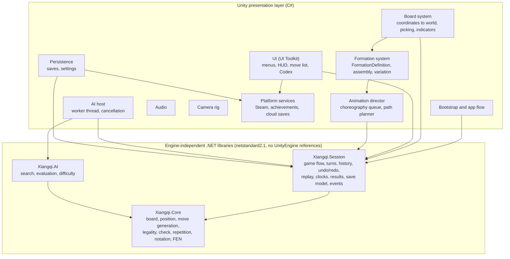
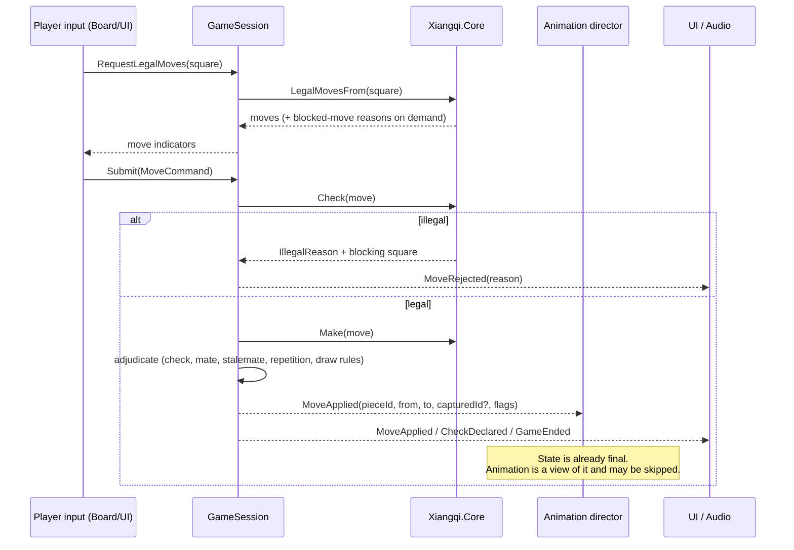

# 07 — Target Architecture

| | |
|---|---|
| Document status | **v0.2: updated for seven selectable states.** Implementation of `Xiangqi.Core` has started (Milestone 2). Becomes the TDD at Milestone 1 |
| Date | 2026-11-20 |
| Assumes | Unity 6 LTS + URP, C# (document 03). The engine-independent layers are unaffected if the engine changes |

---

## 1. Architectural principles

1. **The rules engine is the single source of truth.** Presentation reads state and requests moves. It never decides legality or mutates state.
2. **Dependencies point inward.** `Core` depends on nothing. `Session` and `AI` depend only on `Core`. Unity code depends on these, never the reverse. This is enforced mechanically (§17).
3. **Validate first, then animate.** A move is applied to the authoritative state *before* any animation starts. Animation is a view of a completed fact, and can be skipped or interrupted with no logical effect.
4. **Deterministic and replayable.** Same inputs, same state, same AI choice given the same seed and limits, and the same formation appearance given the same seed.
5. **Data-driven presentation.** Formations, rulesets and quality profiles are data assets, not hard-coded classes.
6. **No unnecessary abstraction.** Interfaces exist where there are real substitutions: tests, platform services, a possible engine port. Not on every class.

## 2. Layer overview



## 3. Module catalogue

| Module | Responsibility | Depends on | Must not |
|---|---|---|---|
| `Xiangqi.Core` | Position representation, move generation, legality (palace, river, eye, leg, screen, self-check, flying general), check and mate detection, Zobrist hashing, repetition data, FEN, notation (ICCS, WXF, Chinese) | — | Reference Unity, do I/O, use wall-clock time or global randomness |
| `Xiangqi.Session` | Game lifecycle, turn order, command handling, history, undo/redo, ruleset adjudication (repetition, perpetual check, draws), clocks, result, game record model, domain events | Core | Reference Unity; know about animations |
| `Xiangqi.AI` | Search and evaluation, difficulty profiles, opening variety (seeded) | Core | Reference Unity; own threads (the host owns threading) |
| `Xiangqi.Tools.Cli` | Perft, FEN debugging, self-play, benchmark harness (talks to external engines over UCI) | Core, Session, AI | Ship with the game |
| Board system (Unity) | Board geometry, coordinate↔world mapping, input picking (nearest intersection), move indicators, threat and check visuals | Session (read), Formation system | Validate moves itself |
| Formation system (Unity) | Instantiate formations from `FormationDefinition` + side + seed; map `PieceId` → formation instance; density tiers; LOD | Assets | Hold logical position as authority |
| Animation director (Unity) | Turns domain events into choreography; queues, skips, interrupts; snaps views to authoritative positions; path planning | Session events, Formation system | Block or delay state changes |
| UI (Unity, UI Toolkit) | Menus, HUD, move list, tooltips (illegal-move reasons), settings, Codex, localisation | Session (read and commands), Platform | Contain game logic |
| Camera rig | Presets, limits, transitions, analysis view | — | Move during input unless the player asks |
| Audio | Music state, signals (drum and bell), SFX from events | Session events | Gate gameplay |
| AI host | Runs AI searches on a worker thread with a time limit and cancellation token; delivers the chosen move as a normal command | AI, Session | Touch Unity objects off the main thread |
| Persistence | Save and load game records (JSON, versioned), settings, replays | Session, Platform | Store presentation state as truth |
| Platform services | Interface over store features: achievements, cloud saves, overlay, rich presence | — | Leak store APIs into game code |

## 4. Rules engine (`Xiangqi.Core`) design

### 4.1 Representation

- **Board:** a fixed array of 90 cells, padded with sentinel border cells, so the move generator needs no bounds checks. A 10 × 9 grid embedded in a larger padded array is the classic Xiangqi engine layout. It is clear, fast enough for the AI, and easy to test.
- **Pieces:** a byte encoding `(side, type)`, plus a **piece list of 32 stable `PieceId`s** (0–31), so the presentation can map each logical piece to exactly one formation across captures and undo.
- **State:** side to move, Zobrist hash, halfmove counters, and a history stack of undo records (move, captured piece, previous hash, counters).
- **Upgrade path:** if profiling the AI shows a need, 128-bit bitboards (90 squares) can replace the mailbox behind the same API.

### 4.2 Public API sketch (illustrative, not final code)

> **Implemented (M2 increment 1):** see `src/Xiangqi.Core` and its README. Differences from this sketch: the board is a plain 90-cell array with precomputed move tables instead of a padded mailbox; `IllegalReason` gained `InvalidMovePattern` and `SoldierSidewaysBeforeRiver` and dropped `OutOfBoard` (squares are validated when they are created); terminal states are reported by `PositionStatus` (`Ongoing`, `Checkmate`, `Stalemate`).

```csharp
public readonly struct Square { public readonly byte File, Rank; }       // a–i, 0–9
public readonly struct Move   { public readonly Square From, To; }
public enum Side { Red, Black }
public enum PieceType { General, Advisor, Elephant, Horse, Chariot, Cannon, Soldier }

public enum IllegalReason {
    None, NotYourPiece, NoPieceAtSource, OutOfBoard, PalaceRestriction, RiverRestriction,
    ElephantEyeBlocked, HorseLegBlocked, PathObstructed, CannonNeedsOneScreen,
    SoldierCannotMoveThatWay, OwnPieceAtTarget, LeavesGeneralInCheck, FlyingGeneral
}

public sealed class Position {
    public static Position FromFen(string fen);
    public string ToFen();
    public Side SideToMove { get; }
    public ulong Hash { get; }
    public PieceInfo? PieceAt(Square s);             // includes stable PieceId
    public IReadOnlyList<Move> LegalMoves();
    public IReadOnlyList<Move> LegalMovesFrom(Square s);
    public MoveCheck Check(Move m);                   // legal? if not, IllegalReason (+ blocking square)
    public bool IsInCheck(Side side);
    public UndoRecord Make(Move m);                   // precondition: legal
    public void Unmake(in UndoRecord u);              // restores the exact previous state, including hash
}
```

`MoveCheck` returning a **reason and a blocking square** is a deliberate requirement. It powers the UI's rule explanations ("Horse leg blocked by the Soldier at e3") without the UI reimplementing any rules.

### 4.3 Rulesets

`RulesetDefinition` (data): repetition adjudication mode (`casual`, `basic-asian`, `wxf`, ...), move-limit count, automatic insufficient-material draw, undo policy, draw offers. The **movement rules are not configurable**. Only adjudication options that differ between official rulesets are (document 02, §5).

## 5. Game state and session (`Xiangqi.Session`)

### 5.1 Commands and events



- **Commands:** `MoveCommand`, `UndoCommand`, `RedoCommand`, `ResignCommand`, `OfferDrawCommand`, `AcceptDrawCommand`, `NewGameCommand(fen, ruleset)`.
- **Events:** `MoveApplied`, `MoveRejected`, `CheckDeclared`, `GameEnded(result, reason)`, `UndoApplied`, `HistoryChanged`.
- Events are plain C# objects. The Unity layer subscribes, and Unity does not appear in the session's API.

### 5.2 History, undo and replay

- History stores moves plus undo records. Undo calls `Unmake` and **restores hash, counters and repetition history exactly**. This is a tested property (document 11, QG-05).
- Replay rebuilds any ply by playing moves from the start FEN through `Core`, so replay can never diverge from the rules.

## 6. Board system (Unity)

- One `BoardGeometry` component maps `Square` ↔ world position from a board-pitch value `P`. Everything visual uses it.
- **Picking:** raycast to the board plane, then select the **nearest intersection within 0.5 P**. Players never need to click a figure precisely.
- Indicators (selection ring, legal targets, last move, check line, flying-general explanation line) are drawn by a dedicated indicator renderer that is always visible (document 05, §7).

## 7. Piece and formation system

### 7.1 Data model

```text
StateDefinition (ScriptableObject), one per state: Qin, Chu, Qi, Zhao, Yan, Wei, Han
  id, displayNames (localised), emblem (regional-script glyph texture)
  palette (primary, secondary), alternatePalette (for same-state matches)
  identityLayer: part-library overrides (armour, headgear, shields, signature weapons)
  banner designs, music motif, Codex entries, registerIds[]

FormationDefinition (ScriptableObject), one per piece type (shared by all states)
  pieceType
  base: BaseDefinition (mesh, rim material driven by state colour,
        band pattern driven by turn role, glyph texture driven by turn role)
  slots[]: FormationSlot
      role (Principal | Signature | Support), localPosition (in P units), facing
      archetype: FigureArchetype (skeleton, part library, allowed variants)
      densityTier (Full | Reduced | Always)
      animationSet: FormationAnimationSet
  footprintRadius (≤ 0.45 P, validated in editor), heightTier
  registerIds[] (links to the historical reference register)
```

- **Assembly:** `FormationFactory.Create(definition, state, turnRole, paletteVariant, seed, densityTier)` builds a formation deterministically from the shared part library, the state's identity layer and paint-mask palettes (document 05, §6.5). That gives 7 piece definitions × 7 state definitions, not 49 hand-built formations.
- **State is presentation-only.** `Xiangqi.Core` and `Xiangqi.Session` know only Red/Black (first/second player). The chosen states live in the game setup and the save file, and never reach rules code.
- **Identity mapping:** `FormationRegistry` maps the 32 `PieceId`s to formation instances. Captured formations are hidden or pooled, not destroyed, so undo is instant.
- **Editor validation:** footprint radius, height tier, missing register IDs, triangle budgets and LODs are checked when a definition is saved and in CI.

## 8. Character and environment assets

- **Asset catalogue:** each asset has a metadata record (author, tool, licence, register IDs, budget compliance), checked into the repository next to the asset.
- **Loading:** a single battlefield scene. All 32 formations are preloaded at board entry. Addressables are considered only for future army sets (decision at Milestone 3).
- **LOD:** LOD groups with a quality-dependent bias. Supporting figures may switch to vertex-animation-texture variants on low tiers (decided after measurement).

## 9. Animation system

- **AnimationDirector** consumes domain events and builds a **choreography** per event: an ordered set of tracks (defender yields, attacker moves along a planned path, projectile, camera accent, audio cues).
- **Authoritative snapping:** when a choreography completes, is skipped, or is interrupted by a new event (undo, fast replay, the next move), every affected formation snaps to its `BoardGeometry` position for the authoritative square. Logical state never waits for animation.
- **Path planner:** produces the move paths documented in document 06, §4: orthogonal-then-diagonal for the Horse, via the eye point for the Strategist (Elephant), and an offset bulge for the Crossbow unit (Cannon) passing its screen. It guarantees no footprint overlap.
- **Per-figure animation:** Unity Animator with a shared humanoid controller per role. Idle desynchronisation by seed. Animator culling and update-rate reduction for off-focus formations.
- **Settings:** speed multiplier, instant mode, reduced motion. All three are applied in the director.

## 10. User interface

- **UI Toolkit** (UXML layouts, USS styles): resolution-independent, scaled by panel settings for high DPI, themable through USS variables (the lacquer theme).
- Text through dynamic SDF font assets with CJK fallback chains. Localisation tables for English, Simplified Chinese and Traditional Chinese (tool choice: decision in Milestone 1).
- The UI talks to the session through a thin presenter layer (view models), and is fully keyboard and gamepad navigable.

## 11. AI opponent (`Xiangqi.AI`)

| Component | Plan |
|---|---|
| Search | Iterative deepening, principal variation search (alpha-beta), aspiration windows |
| Transposition table | Zobrist-keyed, fixed size, depth-preferred replacement |
| Quiescence | Captures and check evasions |
| Move ordering | Hash move, MVV-LVA captures, killer moves, history heuristic |
| Extensions and pruning | Check extension; null-move pruning with Xiangqi-specific safeguards; late move reductions (after test validation) |
| Repetition | Ruleset-aware repetition handling inside the search, so the AI never chooses a losing perpetual |
| Evaluation | Material (initial values from common Xiangqi practice, e.g. chariot ≈ 9, cannon ≈ 4.5, horse ≈ 4, advisor and elephant ≈ 2, soldier 1 rising to 2 after crossing), piece-square tables, general safety, mobility. Later tuned on self-play and engine-labelled positions |
| Difficulty | Per level: time and depth limit, evaluation noise, top-N move sampling (seeded), blunder model for the lowest levels |
| Threading | The AI host runs the search on a worker thread with a time limit and cancellation (on undo, quit or new game) |
| Benchmarking | Tactical test positions; matches against Fairy-Stockfish at fixed nodes or time **as an external process in the test harness only (GPL; never shipped)**; Elo estimates with confidence intervals |

## 12. Audio

- Event-driven: domain events map to audio cues (drum for moves and advances, bell for withdrawal and undo, check stinger, capture).
- Music state machine with intensity layers (opening, middlegame, check, endgame, result).
- Mixer groups (music, signals, SFX, ambience, UI) with user volume settings.
- Engine-native audio by default; middleware only if the Milestone 1 evaluation justifies it.

## 13. Save and load

```json
{
  "schemaVersion": 1,
  "rulesetId": "basic-asian",
  "startFen": "rnbakabnr/9/1c5c1/p1p1p1p1p/9/9/P1P1P1P1P/1C5C1/9/RNBAKABNR w - - 0 1",
  "moves": ["h2e2", "h9g7"],
  "result": null,
  "players": {
    "red":   { "controller": "human", "state": "qin" },
    "black": { "controller": { "ai": 3 }, "state": "chu", "palette": "primary" }
  },
  "clocks": null,
  "createdUtc": "2026-11-20T00:00:00Z",
  "appVersion": "0.1.0"
}
```

- **Loading replays every move through `Core`.** A save can never produce an illegal or inconsistent state. Corrupt or illegal records are rejected with a clear message.
- Versioned schema with migration functions. Settings are stored separately.
- Atomic writes (temporary file, then rename). Cloud saves through the platform service.

## 14. Platform integration

- `IPlatformServices` with implementations `NullPlatform` (development, tests) and `SteamPlatform` (release).
- Steam features: achievements (optional scope), cloud saves, rich presence, overlay-safe input.
- The build defines and selects the implementation at boot. No store API calls appear outside the implementation.

## 15. Multiplayer (future, not in MVP)

- Option A: an **authoritative server** running the same `Xiangqi.Core` and `Session` on .NET, with clients sending commands and receiving events. This is the recommended option for ranked play.
- Option B: peer-to-peer relay where both clients validate with `Core`. Simpler, but weaker against cheating.
- The design already supports both, because the session is command and event based and deterministic.

## 16. Threading and performance

- The main thread runs Unity, presentation and the session. Session operations are microseconds, so they are synchronous.
- AI search runs on a worker thread on a **cloned position**, returning a `Move`. The session validates it like any human move.
- No allocations in per-frame hot paths (formations, indicators). The move generator writes into preallocated buffers in the AI path.

## 17. Enforcing the boundaries

- `Xiangqi.Core`, `Xiangqi.Session` and `Xiangqi.AI` live in a local Unity package with assembly definitions set to **`noEngineReferences: true`**. Unity itself refuses any `UnityEngine` usage there.
- The same sources are built by standalone `.csproj` files in CI with `dotnet test`. A build fails if anything engine-specific leaks in.
- Unity assemblies are split by area (`Presentation`, `Formations`, `Animation`, `UI`, `Platform`, `Editor`) with explicit references, so cycles cannot form.

## 18. Repository layout (proposed)

```text
/                          README, LICENSE (TBD), .gitattributes (LFS), .editorconfig
/docs/preproduction/       this package
/docs/adr/                 architecture decision records
/docs/tdd/                 technical design (from Milestone 1)
/src/Xiangqi.Core/         engine-independent libraries (shared with Unity as a local package)
/src/Xiangqi.Session/
/src/Xiangqi.AI/
/src/Xiangqi.Tools.Cli/
/tests/Xiangqi.Core.Tests/       NUnit (runs in dotnet test and the Unity Test Runner)
/tests/Xiangqi.Session.Tests/
/tests/Xiangqi.AI.Tests/
/tests/data/                     FEN suites, perft tables, rule-case corpus, repetition cases
/game/                     Unity project
    Assets/_Project/{Scripts,Art,Data,Scenes,UI,Audio,Tests}
    Packages/              includes a local reference to /src as a package
/tools/                    CI scripts, asset validators
/.github/workflows/        CI pipelines
```

## 19. Testing architecture (summary; full criteria in document 11)

| Level | Tooling | Runs where |
|---|---|---|
| Rules unit tests (every rule, every piece, reasons) | NUnit | `dotnet test` (CI, this container) and the Unity Test Runner |
| Perft and move-generation conformance | NUnit + perft tables | CI |
| Property tests (make/unmake round-trip, FEN round-trip, hash consistency over random games) | NUnit with seeded random games (no extra dependency) | CI |
| Session and adjudication (repetition, perpetual check, draws, undo, save/load) | NUnit | CI |
| AI legality (self-play, thousands of games, no illegal moves) and response time | CLI + NUnit | CI (time-boxed), nightly |
| Presentation integration (events → formation positions agree with state after any sequence, including skips and undo) | Unity play-mode tests | Unity CI |
| Visual and readability | Screenshot capture at fixed seeds and camera presets; human review protocols | GPU runner and review sessions |
| Performance | Unity Profiler captures and frame-time logs on reference hardware | Nightly on the GPU runner |

## 20. Architecture decision records to write in Milestone 1

| ADR | Topic |
|---|---|
| ADR-0001 | Engine and render pipeline (after the spike) |
| ADR-0002 | Engine-independent C# core with `noEngineReferences` |
| ADR-0003 | Board representation (padded mailbox; bitboards deferred) |
| ADR-0004 | Event-driven presentation; validate-then-animate |
| ADR-0005 | Save format: start FEN + ICCS move list, replayed through Core |
| ADR-0006 | Ruleset model and repetition adjudication staging |
| ADR-0007 | Formation data model and deterministic assembly |
| ADR-0008 | Asset storage (LFS) and validation pipeline |
