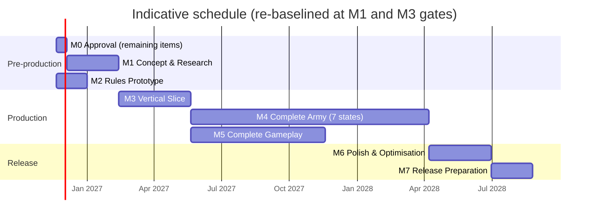

# 09 — Development Roadmap

| | |
|---|---|
| Document status | **v0.2: revised after your decisions** (seven states; Windows only). **Milestone 2 has started** |
| Date | 2026-11-20 |
| Planning basis | Small core team with outsourced art (D12, approved). **Durations are indicative (±30%)** and will be re-baselined at the Milestone 1 and Milestone 3 gates |

---

## 1. Milestone overview

| Milestone | Objective | Indicative duration | Gate |
|---|---|---|---|
| **M0 Pre-production approval** | Approve direction | **Mostly done**: D8 and D15–D18 pending | Decision log (document 10) |
| **M1 Concept and Research** | Lock art direction for seven states; concept art; engine spike; GDD and TDD v1.0 | 8–10 weeks (was 6–8: seven state identity sheets) | Historical design approval gate; engine spike pass |
| **M2 Rules Prototype** | Complete, tested rules engine with a test AI and CLI | 4–6 weeks; **started 2026-11-20** | Rules acceptance (document 11 §2) |
| **M3 Visual Vertical Slice** | Finished board, Chariot formations for two states, full mechanics, polished UI | 12–16 weeks | Slice go/no-go (document 08) |
| **M4 Complete Army Development** | **All 7 piece types × 7 states (49 formation variants)** from the shared kit plus seven identity layers | **9–12 months** (was 6–9) | All formation variants signed off |
| **M5 Complete Gameplay** | All approved modes, state selection, AI levels, save/load, settings, tutorial, Codex (including seven state entries), localisation | In parallel with M4 (≈ 6 months) | Feature complete (Alpha) |
| **M6 Polish and Optimisation** | Audio (including state motifs), VFX, performance, accessibility, bug fixing, Beta | 3 months | Beta exit criteria |
| **M7 Release Preparation** | Release candidate, compatibility (Windows), store, legal, documentation | 6–8 weeks | Release acceptance (document 11 §8) |

**Indicative total from M1 start to release: about 21–26 months** (was 18–22). The increase comes from seven state identity layers instead of two armies. The critical path runs through art production (M3 → M4). Adding outsourcing capacity in M4 can shorten it; the cost estimate is in §4.

## 2. Indicative schedule

Purely illustrative.

## 3. Milestone detail

### M1: Concept and Research (8–10 weeks)

| Work | Deliverable |
|---|---|
| Historian (Warring States military) and palaeography consultant engagement; verify every V0/V1 register entry used for identity-critical elements, with priority on Zhao, Yan, Qi, Wei and Han | Register v1.0 (V2 for identity-critical items) |
| ***Qin Dynasty Epic* reference sheet** (internal, rights-respecting); reconcile the state palette; trace each borrowed look to its artefact | Reference sheet; palette v1.0 |
| Reference boards: mood, common kit, **seven state boards**, environment, negative board | Boards (internal) |
| Concept art: 2 style frames; 7 base formation sheets; **7 state identity sheets**; base, band, emblem and glyph sheet (28 pairings under colour-blind simulation); Changping battlefield paintover; UI style sheet. Generative AI allowed for exploration only (D11) | Concept pack |
| **Greybox readability test** at target scale in the engine, including the turn-role band and state colours | Readability report |
| **Engine spike (2 weeks):** about 160-actor animated scene, 4K frame time on Windows reference hardware, UI Toolkit CJK, one test character through the pipeline | Spike report; ADR-0001 |
| GDD v1.0, TDD v1.0, ADRs 0001–0008 | Documents |
| Production plan re-baseline (team, budget, vendors) | Plan v1.0 |

**Exit criteria:** art direction for all seven states approved (historical design approval gate); engine confirmed; greybox readability passes; budget and team model approved; D8 and D15–D18 decided.

### M2: Rules Prototype (4–6 weeks): in progress

| Work | Status |
|---|---|
| `Xiangqi.Core`: representation, move generation, legality with reasons, check/mate/stalemate, flying general, Zobrist, FEN, ICCS notation | **Increment 1 done (2026-11-20)**: 77/77 tests; perft matches published values and an independent engine (`docs/testing/test-register.md`) |
| WXF and Chinese notation | Planned (increment 2) |
| `Xiangqi.Session`: commands and events, history, undo/redo, `casual` and `basic-asian` adjudication, draw rules, save model | Planned (increment 2) |
| Test suites: per-rule tests, perft conformance, property tests, adjudication and save/load tests | Rule, perft, property and external-reference suites done; adjudication and save/load with increment 2 |
| `Xiangqi.AI` baseline (alpha-beta, TT, quiescence) | Planned (increment 3) |
| CLI: perft, FEN tools, self-play, benchmark harness | `perft`, `divide`, `fen`, `perft-file` done; self-play and benchmark with increment 3 |
| CI pipeline for libraries | Workflow added (`.github/workflows/ci.yml`); first GitHub run happens on push |

**Exit criteria:** document 11 §2 rules criteria met (QG-01 to QG-10); AI produces only legal moves in self-play.

### M3: Visual Vertical Slice (12–16 weeks)

Specified in **document 08**. Exit: slice go/no-go with evidence pack and re-planned M4 (now including measured cost per state identity layer).

### M4: Complete Army Development (9–12 months)

| Work | Notes |
|---|---|
| Remaining six piece types on the shared kit | Order by risk and reuse: Horse (reuses the horse rig) → Soldier (variation system at scale) → Crossbow unit → Advisor → General → Strategist |
| State identity layers | Order by evidence strength: **Qin, Chu** (slice) → **Zhao, Wei, Han** (shared Jin script group and related kits) → **Qi, Yan** |
| Modular part libraries and paint-mask variation for seven states | Document 05 §6.5 |
| Full animation set | Document 06 §4 (shared across states) |
| LODs, density tiers, optimisation passes | Budgets enforced by validators |
| Historian sign-off | Per piece type and per state |

**Exit criteria:** all 49 formation variants pass the QV and QH criteria; performance within budgets for any pairing.

### M5: Complete Gameplay (parallel with M4)

Versus AI (6 levels, benchmarked), hotseat, **state selection with same-state matches and who-moves-first options**, tutorial, Codex (rules, seven states, units, evidence labels), replay and analysis, save/load UI, all settings, localisation (EN, zh-Hans, zh-Hant), full keyboard and gamepad support, WXF ruleset, Steam integration.

**Exit criteria (Alpha):** feature complete; all modes playable end to end; no blocking bugs.

### M6: Polish and Optimisation (3 months)

Music (including a short motif per state, if approved) and SFX; VFX polish; performance on all Windows tiers; accessibility review; UI refinement; bug fixing; closed external Beta.

### M7: Release Preparation (6–8 weeks)

Release candidate builds; Windows compatibility matrix; store page assets and AI-content disclosure as applicable; EULA and privacy; licence audit; known-issue register; final acceptance; launch.

## 4. Team and capacity model (D12 approved)

| Discipline | Model | Indicative effort (person-months, ±50%) |
|---|---|---|
| Game direction and production | You (approval authority) | — |
| Engineering (gameplay, tools, AI, UI, build) | 1–2 engineers, AI-assisted | 18–30 |
| Concept art | Contract | **5–8** (was 3–5) |
| Character, vehicle and kit art: shared kit + **seven identity layers** | Outsourced under this team's specifications | **45–70** (was 30–45) |
| Animation (shared across states) | Contract or outsourced | 13–20 |
| Environment and board art | Contract | 6–10 |
| Technical art (shaders, LOD, pipeline, validation, palettes) | Part-time specialist + engineering | 7–11 |
| UI/UX design and art (including state selection, emblems) | Contract | 6–9 |
| Audio (music, state motifs, SFX) | Contract | 4–7 |
| QA (including 28-pairing readability matrix) | Part-time, then full-time from Beta | 7–11 |
| Historian and palaeography consultants | Part-time review roles | 2–3 |
| **Total (indicative)** | | **≈ 115–180** (was 90–145) |

These are order-of-magnitude numbers for budgeting discussions, not quotes. They are replaced by measured slice rates at the M3 gate.

## 5. Branching and repository plan

| Branch | Purpose |
|---|---|
| `main` | Stable baseline; protected; reviewed merges only |
| `claude/sleepy-hamilton-7inm6s` | **Current working branch for this session:** pre-production package and Milestone 2 increment 1. Merged to `main` through a pull request when you approve |
| `feature/xiangqi-engine`, `feature/game-ai`, `feature/engine-spike` | Proposed for later increments, created only with your permission |
| `feature/battlefield-environment`, `feature/military-formations`, `feature/animation-system`, `feature/ui-ux`, `feature/audio` | Production features from M3 |
| `release/beta`, `release/1.0` | Stabilisation branches |

No force-pushes, branch deletions, history rewrites, major merges or releases without your explicit approval.

## 6. Reporting cadence

- **End of every milestone:** a milestone report covering the brief's 11 points.
- **Each increment:** a short progress note listing what was built, the tests actually executed, and their results.
- **Approval required before:** changes to game direction, historical setting, engine, architecture or commercial scope.

## 7. Immediate next steps

1. **M2 increment 1 (now):** solution scaffold, `Xiangqi.Core` (board, all piece rules, legality with reasons, check, checkmate, stalemate, flying general, Zobrist, FEN, ICCS), tests including perft conformance, perft CLI, CI workflow.
2. **Your answers on D8 (with the clarification in document 10 §1.1) and D15–D18.**
3. **M1 preparation:** historian and palaeography consultant search; *Qin Dynasty Epic* reference sheet plan; concept-art briefs for the seven state identity sheets.
