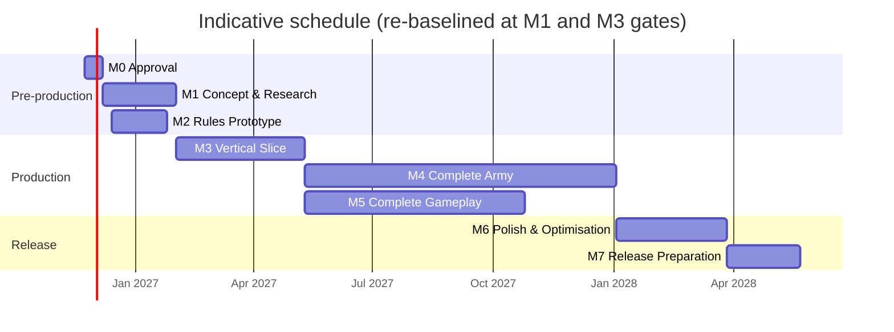

# 09 — Development Roadmap

| | |
|---|---|
| Document status | **Draft v0.1, submitted for approval** |
| Date | 2026-11-20 |
| Planning basis | Small core team with outsourced art (decision D12). **Durations are indicative (±30%)** until team, budget and engine are confirmed; they will be re-baselined at the Milestone 1 and Milestone 3 gates |

---

## 1. Milestone overview

| Milestone | Objective | Indicative duration | Gate |
|---|---|---|---|
| **M0 Pre-production approval** | Approve direction (this package) | 1–2 weeks (your review) | Decisions D1–D14 |
| **M1 Concept and Research** | Lock setting, art direction, engine; concept art; GDD and TDD v1.0 | 6–8 weeks | Historical design approval gate; engine spike pass |
| **M2 Rules Prototype** | Complete, tested rules engine with a test AI and CLI | 4–6 weeks (parallel with M1) | Rules acceptance (document 11 §2) |
| **M3 Visual Vertical Slice** | One finished board, Chariot formations (both armies), full mechanics, polished UI | 12–16 weeks | Slice go/no-go (document 08) |
| **M4 Complete Army Development** | All 7 piece types × 2 armies; variation; full animation set; optimisation | 6–9 months | Art complete, all formations signed off |
| **M5 Complete Gameplay** | All approved modes, AI levels, save/load, settings, tutorial, Codex, localisation | Runs in parallel with M4 (≈ 5–6 months) | Feature complete (Alpha) |
| **M6 Polish and Optimisation** | Audio, VFX, performance, accessibility, bug fixing, Beta | 3 months | Beta exit criteria |
| **M7 Release Preparation** | Release candidate, compatibility, store, legal, documentation | 6–8 weeks | Release acceptance (document 11 §8) |

**Indicative total from M1 start to release: about 18–22 months.** The critical path runs through art production (M3 → M4).

## 2. Indicative schedule

Dates assume approval by early December 2026. Purely illustrative.

## 3. Milestone detail

### M1: Concept and Research (6–8 weeks)

| Work | Deliverable |
|---|---|
| Historian engagement; verify all V0/V1 register entries used for identity-critical elements | Register v1.0 (V2 for identity-critical items) |
| Reference and mood boards (rights recorded) | Boards (internal) |
| Concept art: 2 style frames, 14 piece sheets, base and glyph sheet, board and environment paintover, UI style sheet | Concept pack |
| **Greybox readability test**: blockout formations at the target scale on the board, in the engine | Readability report; footprint and scale confirmed |
| **Engine spike (2 weeks)**: 160-actor animated scene, 4K frame time on reference hardware, UI Toolkit CJK, one test character through the pipeline | Spike report; ADR-0001 |
| GDD v1.0, TDD v1.0, ADRs 0001–0008 | Documents |
| Production plan re-baseline (team, budget, outsourcing vendors) | Plan v1.0 |

**Exit criteria:** setting and art direction approved (historical design approval gate); engine confirmed; greybox readability passes; budget and team model approved.

### M2: Rules Prototype (4–6 weeks; can start immediately after approval)

| Work | Deliverable |
|---|---|
| `Xiangqi.Core`: representation, move generation, legality with reasons, check/mate/stalemate, flying general, Zobrist, FEN, notation | Library + API docs |
| `Xiangqi.Session`: commands and events, history, undo/redo, `casual` and `basic-asian` adjudication, draw rules, save model | Library |
| Test suites: per-rule tests, perft conformance, property tests, adjudication and save/load tests | Test register |
| `Xiangqi.AI` baseline (alpha-beta, TT, quiescence) for testing and early play | Library |
| CLI: perft, FEN tools, self-play, benchmark harness | Tool |
| CI pipeline for libraries | Green CI |

**Exit criteria:** document 11 §2 rules criteria met (QG-01 to QG-08); AI produces only legal moves in self-play.

M2 needs no art and no engine decision, so it can run in this cloud environment in parallel with M1. It is the lowest-risk way to start producing verifiable value.

### M3: Visual Vertical Slice (12–16 weeks)

Specified fully in **document 08**. Exit: slice go/no-go with evidence pack and re-planned M4.

### M4: Complete Army Development (6–9 months)

| Work | Notes |
|---|---|
| Remaining six piece types × 2 armies | Order by risk and reuse: Horse (reuses horse rig) → Soldier (variation system at scale) → Advisor → General → Cannon (machine) → Elephant/Minister (elephant rig; Han chancellor) |
| Modular part libraries and paint-mask variation for both armies | Document 05 §6.5 |
| Full animation set | Document 06 §3 |
| LODs, density tiers, optimisation passes | Per formation, budgets enforced by validators |
| Historian sign-off per formation | Per piece type |
| Environment variants (optional, scope-dependent) | Lighting presets |

**Exit criteria:** all 14 formation variants pass QV and QH criteria; performance within budgets with all formations on the board.

### M5: Complete Gameplay (parallel with M4)

Versus AI (6 levels, benchmarked), hotseat, tutorial, Codex, replay and analysis, save/load UI, all settings, localisation (EN, zh-Hans, zh-Hant), full keyboard and gamepad support, WXF ruleset (if approved, D9), Steam integration.

**Exit criteria (Alpha):** feature complete; all modes playable end to end; no blocking bugs.

### M6: Polish and Optimisation (3 months)

Music and SFX final; VFX polish; performance optimisation on all tiers; accessibility review; UI refinement; bug fixing; external Beta (closed playtest).

**Exit criteria (Beta → RC):** performance targets met on all tiers; zero open severity 1–2 bugs; accessibility checklist complete; crash rate below threshold (document 11 §8).

### M7: Release Preparation (6–8 weeks)

Release candidate builds; compatibility matrix testing; store page assets (trailer, screenshots, AI disclosure as applicable); EULA and privacy; licence audit of all assets, fonts and audio; known-issue register; final acceptance assessment; launch.

## 4. Team and capacity model (assumption for decision D12)

| Discipline | Model | Indicative effort (person-months, ±50%) |
|---|---|---|
| Game direction and production | You (approval authority), supported by this team's documentation | — |
| Engineering (gameplay, tools, AI, UI, build) | 1–2 engineers, AI-assisted (Claude Code for code, tests, tools, docs) | 18–30 |
| Concept art | Contract | 3–5 |
| Character, creature and vehicle art | Outsourced studio or contractors under this team's specifications | 30–45 |
| Animation (motion capture + keyframe) | Contract or outsourced | 12–20 |
| Environment and board art | Contract | 6–10 |
| Technical art (shaders, LOD, pipeline, validation) | Part-time specialist + engineering | 6–10 |
| UI/UX design and art | Contract | 5–8 |
| Audio (music, SFX) | Contract | 3–6 |
| QA | Part-time, then full-time from Beta | 6–10 |
| Historian consultant | Part-time review role | 1–2 |
| **Total (indicative)** | | **≈ 90–145** |

These figures are order-of-magnitude planning numbers for budgeting discussions, not quotes. They will be replaced by measured slice production rates at the M3 gate.

## 5. Branching and repository plan

The structure in the brief is adapted to this repository:

| Branch | Purpose |
|---|---|
| `main` | Stable baseline; protected; only reviewed merges |
| `claude/sleepy-hamilton-7inm6s` | This pre-production package (current session branch) |
| `feature/xiangqi-engine` | M2 rules engine, session, tests |
| `feature/game-ai` | AI search and evaluation |
| `feature/engine-spike` | M1 engine spike (throwaway code, kept for reference) |
| `feature/battlefield-environment`, `feature/military-formations`, `feature/animation-system`, `feature/ui-ux`, `feature/audio` | Production features from M3 |
| `release/beta`, `release/1.0` | Stabilisation branches |

No force-pushes, branch deletions, history rewrites, major merges or releases without your explicit approval. Every change is incremental and reviewable through pull requests.

## 6. Reporting cadence

- **End of every milestone:** a milestone report covering the 11 points required by the brief (objective, work completed, files changed, architecture decisions, assets created or still required, tests executed, test results, performance, outstanding issues, risks, next activities).
- **During milestones:** short progress notes per pull request; the risk register is updated whenever it changes.
- **Approval required before:** any change to game direction, historical setting, engine, architecture or commercial scope.

## 7. Immediate next steps after approval

1. Record your decisions on D1–D14 (document 10) as ADRs and update this package to v1.0.
2. **Start M2** (rules engine) on `feature/xiangqi-engine`. It is independent of art and engine choices.
3. **Start M1** in parallel: historian engagement, concept-art briefs, engine spike plan, readability greybox plan.
